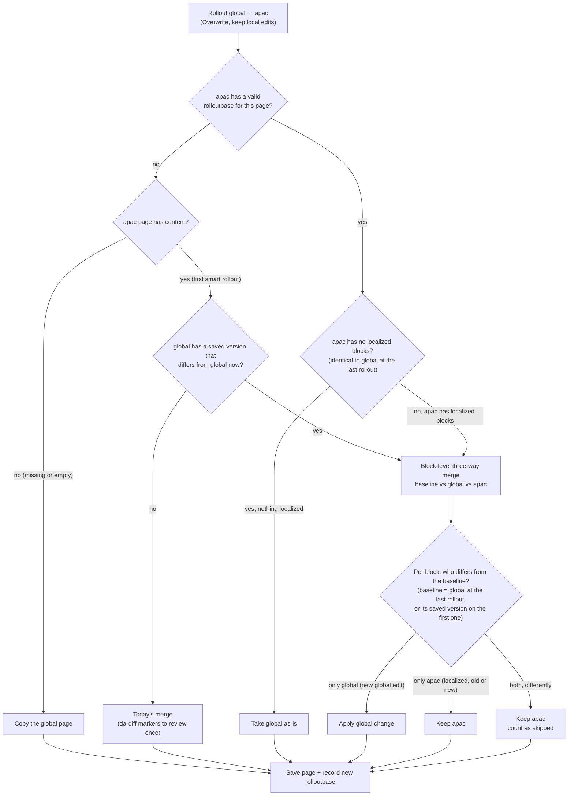

# Rollout: Overwrite (keep local edits)

`smart-overwrite` is an opt-in rollout behavior. It rolls out only the upstream (e.g. global) changes made since the
last rollout to each destination (e.g. apac) and keeps blocks the destination has localized.

Existing `overwrite` and `merge` behaviors are unchanged.

## Enabling

Add `smart-overwrite` to `rollout.conflict.behavior` in the site's `/.da/translate.json` config sheet, for example:

| key | value |
|---|---|
| `rollout.conflict.behavior` | `merge, overwrite, smart-overwrite` |

- **Loc app**: the value appears in the "On rollout" option (the first value stays the default).
- **Library rollout plugin**: "Overwrite (keep local edits)" appears in the Behavior select.

## How it works



Each smart rollout stores a baseline in the destination's `da-metadata`:

```
rolloutbase = <destination path>|<ordered upstream block hashes>
```

The next smart rollout does a block-level three-way merge (diff3, like `git merge`) of baseline (B), current
upstream (S) and destination (D). Logic lives in `nx/public/loc/smart-merge.js` (merge) and
`nx/public/loc/smart-overwrite.js` (read/save); both are Nexter-internal (not exported from `nx/public/loc/index.js`).

1. Diff B→S and B→D into change hunks (ranges of baseline blocks replaced by new blocks). Equal-length replacements
   are treated as in-place edits of each block.
2. Hunks from the two sides that overlap form a cluster. Adjacent changes do not overlap, so an upstream edit or
   insert next to a localized block is still applied.
3. Each cluster is resolved:

| Upstream | Destination | Result |
|---|---|---|
| changed | unchanged | apply upstream change (edit, insert, delete) |
| unchanged | changed | keep destination |
| changed identically | changed identically | keep destination |
| inserted at a spot | inserted at the same spot | keep both (destination first, no duplicates) |
| changed | changed differently | keep destination, count as **skipped** |

4. Upstream reorders: if the destination has no localized blocks (it is still identical to upstream as of the last
   rollout), the result is exactly upstream (reorders included). Otherwise, like merge, upstream moves are not
   applied: moved blocks stay in the destination's order (not reported), so content is never duplicated, lost or
   resurrected. The recorded baseline keeps that (unapplied) order, so later upstream edits to moved blocks still
   apply. Reordered sections are put back as whole units, so edits inside a moved section (such as its section
   metadata) stay with that section.
5. Sections: new sections inserted by both sides at the same spot are compared whole, so boundaries and section
   metadata stay with their content. Section breaks that would leave an empty section after merging are dropped,
   unless the destination or upstream already has an empty section.

Guarantees (covered by seeded randomized tests in `test/loc/smart-merge.test.js`):
- Destination identical to the baseline (nothing localized) → result equals upstream.
- Upstream unchanged, or equal to the destination → result equals the destination.
- Every block the destination added or edited is kept.
- No block appears more often than in the destination plus the copies upstream newly added; locally deleted
  blocks never come back.
- A block present exactly once in the baseline, upstream and destination is always kept.
- The merge never creates an empty section.
- If nothing is reported as skipped, every new upstream block was applied.

Skipped counts are shown per locale (Loc app) and per destination (plugin) as "N skipped (localized)".

- No valid baseline yet (first smart rollout, or a baseline that is malformed or recorded for a different path):
  - Destination already identical to upstream: kept exactly as authored; the baseline is recorded.
  - Otherwise the **latest saved version of the upstream page** (the immediate parent, e.g. global for apac and apac
    for en-to) stands in for the baseline. Saved versions come from Preview/Publish in DA, "save version",
    rollouts and translations; ordinary edits do not create one. Versions saved by a rollout into the upstream page
    (labelled `… - Rolled Out`) are ignored: they already contain changes from further up (e.g. global edits just
    rolled out to apac) that the destination has not received. Of the rest, only the newest is used (by date; older
    ones are never tried). It is prepared like the current upstream page (placeholders filled with the
    destination's values, links normalized) and the three-way merge runs as usual: upstream edits made since that
    version are applied, everything else the destination has is kept, overlaps are counted as skipped.
  - Today's merge (every difference marked with `da-diff-*` for the author to review once, honoring earlier
    accept/reject decisions) is used instead when the upstream page has no saved version, when that version is
    identical to the current upstream page (nothing tells new edits apart), or when the destination or that version
    still has unresolved `da-diff-*` markers. Because this is today's merge, it has merge's existing normalizations
    (section wrapper attributes and empty paragraphs are dropped, whitespace in code blocks is not compared); later
    smart rollouts keep them as authored.
  - Either way the baseline is then recorded, and every later smart rollout applies only the upstream changes made
    since. A plain overwrite or merge does not record a baseline, so the first smart rollout after one starts here
    again.
  - Limits of the saved-version fallback: it rolls out "changes since the upstream page's latest saved version",
    not a proven sync point. Upstream edits made after the destination last matched upstream (e.g. after import)
    but before that version count as already handled and are not rolled out; edits after it are. A placeholder
    value changed in the sheet before the first rollout is not rolled out (the destination's old value looks
    local), and destination values typed by hand that differ from the sheet count as local edits. A placeholder the
    sheet no longer defines leaves that version unfilled; affected blocks are kept as the destination has them and
    may be counted as skipped.
  - Chained rollouts (global → region → locale): on the first smart rollout, **roll out each level before
    previewing or publishing the region**. Rollout versions are ignored, but a Preview/Publish of the region after
    it received global changes saves a version that contains them; if the region is then edited, the locale's
    first smart rollout treats those global changes as already handled and does not roll them out. Rolling the
    region out to its locales before previewing it avoids this; once every page has a baseline it no longer matters.
  - Versions are read through legacy DA (`admin.da.live` `/versionlist` and `/versionsource`), the same backend
    the rollout reads pages from, in both the Loc app and the Library plugin. Helix 6 (AEM API) support for the
    rollout as a whole is a follow-up.
- Missing destination, or an empty one without a baseline: the upstream page is copied as-is and the baseline is
  recorded. An empty destination with a baseline was emptied on purpose and is merged like any other.
- Read or save failures (including reading the upstream page's versions) and malformed documents are reported as
  errors and nothing is written; smart-overwrite never falls back to a
  plain overwrite.
- Only smart rollouts read or write `rolloutbase`; a later plain merge leaves a stale baseline, which is safe because
  identical changes are not treated as conflicts.
- Granularity is the block (paragraph, heading, block table, block group). Any edit inside a block counts as a
  change to that block (whitespace is ignored except inside code blocks, `<pre>`), and blocks are matched by
  content: an upstream block that is both moved and edited is seen as a deletion plus a new block, so if the
  destination localized it both versions are kept for the author to tidy. Section wrapper attributes (e.g.
  `<div id="…">`) and empty paragraphs are kept as authored.
