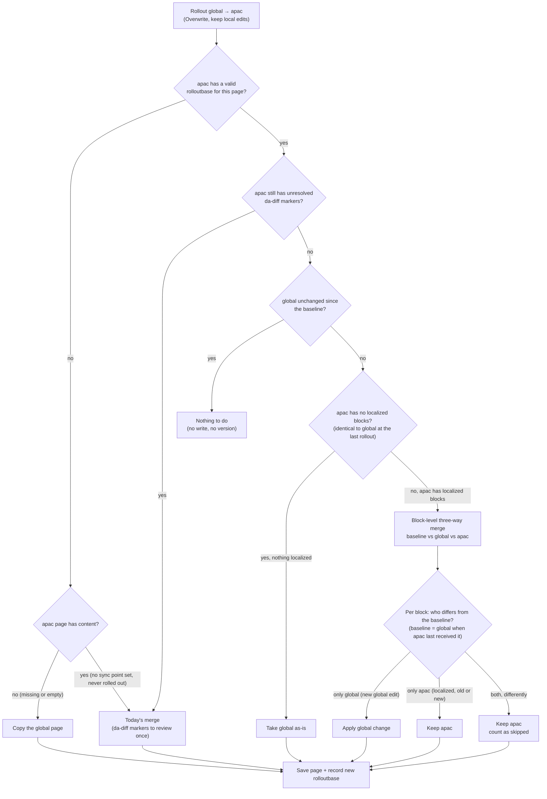

# Rollout: Overwrite (keep local edits)

`smart-overwrite` is an opt-in rollout behavior. It rolls out only the upstream (e.g. global) changes made since the
last rollout to each destination (e.g. apac) and keeps blocks the destination has localized.

Existing `overwrite` and `merge` behaviors are unchanged.

## Enabling

Add `smart-overwrite` to `rollout.conflict.behavior` in the site's `/.da/translate.json` config sheet, for example:

| key | value |
|---|---|
| `rollout.conflict.behavior` | `merge, overwrite, smart-overwrite` |

- **Loc app**: the value appears in the "On rollout" option (the first value stays the default). Projects that use
  it also get a **Set sync point** action per language (see below).
- **Library rollout plugin**: "Overwrite (keep local edits)" and "Set sync point (no content change)" appear in the
  Behavior select.

Everything on this page (baselines, sync points) only happens on sites that opt in. Other sites behave exactly as
before.

## How it works



Each page stores a baseline in its `da-metadata`: the upstream page as this page last received it.

```
rolloutbase = <destination path>|<ordered upstream block hashes>
```

On opted-in sites the baseline is recorded by:
- every smart rollout ("Overwrite (keep local edits)");
- plain **merge** and **overwrite** rollouts from the Loc app (including the legacy project rollout view) or the
  Library plugin (overwrite: the page now equals upstream; merge: upstream at review time, so blocks the author keeps
  local stay local afterwards);
- **Set sync point** (below).

Snapshots, translations and sync do not record baselines, and neither do rollouts or sync points into snapshot
paths (`/.snapshots/…`). A snapshot keeps the page's baseline, so edits made in a snapshot count as local edits when
merged or overwritten back. Translations and sync write the upstream (language)
pages, so they are upstream edits that roll out normally.

The next smart rollout does a block-level three-way merge (diff3, like `git merge`) of baseline (B), current
upstream (S) and destination (D). Logic lives in `nx/public/loc/smart-merge.js` (merge) and
`nx/public/loc/smart-overwrite.js` (read/save); both are Nexter-internal (not exported from `nx/public/loc/index.js`).

1. Diff B→S and B→D into change hunks (ranges of baseline blocks replaced by new blocks). Equal-length replacements
   are treated as in-place edits of each block.
2. Hunks from the two sides that overlap form a cluster. Adjacent changes do not overlap, so an upstream edit or
   insert next to a localized block is still applied.
3. Each cluster is resolved:

| Upstream | Destination | Result |
|---|---|---|
| changed | unchanged | apply upstream change (edit, insert, delete) |
| unchanged | changed | keep destination |
| changed identically | changed identically | keep destination |
| inserted at a spot | inserted at the same spot | keep both (destination first, no duplicates) |
| changed | changed differently | keep destination, count as **skipped** |

4. Upstream reorders: if the destination has no localized blocks (it is still identical to upstream as of the last
   rollout), the result is exactly upstream (reorders included). Otherwise, like merge, upstream moves are not
   applied: moved blocks stay in the destination's order (not reported), so content is never duplicated, lost or
   resurrected. The recorded baseline keeps that (unapplied) order, so later upstream edits to moved blocks still
   apply. Reordered sections are put back as whole units, so edits inside a moved section (such as its section
   metadata) stay with that section.
5. Sections: new sections inserted by both sides at the same spot are compared whole, so boundaries and section
   metadata stay with their content. Section breaks that would leave an empty section after merging are dropped,
   unless the destination or upstream already has an empty section.

Guarantees (covered by seeded randomized tests in `test/loc/smart-merge.test.js`):
- Destination identical to the baseline (nothing localized) → result equals upstream.
- Upstream unchanged, or equal to the destination → result equals the destination.
- Every block the destination added or edited is kept.
- No block appears more often than in the destination plus the copies upstream newly added; locally deleted
  blocks never come back.
- A block present exactly once in the baseline, upstream and destination is always kept.
- The merge never creates an empty section.
- If nothing is reported as skipped, every new upstream block was applied.

Skipped counts are shown per locale (Loc app) and per destination (plugin) as "N skipped (localized)". A skipped
change is not offered again: the next baseline already contains it.

- Unresolved review: while the destination still has `da-diff-*` markers (e.g. a first-run merge review that
  was not resolved yet), every smart rollout is today's merge again, honoring earlier accept/reject decisions,
  even when a baseline exists. Pending upstream changes keep showing until the author resolves them and are never
  dropped; once the markers are gone, the next smart rollout uses the baseline.

- No valid baseline yet (no sync point set and never rolled out on this site, or a baseline that is malformed or
  recorded for a different path):
  - Destination already identical to upstream: kept exactly as authored; the baseline is recorded.
  - Otherwise today's merge (every difference marked with `da-diff-*` for the author to review once, honoring
    earlier accept/reject decisions), and the baseline is recorded. Because this is today's merge, it has merge's
    existing normalizations (section wrapper attributes and empty paragraphs are dropped, whitespace in code blocks
    is not compared); later smart rollouts keep them as authored.
  - To skip that one-time review for content that already exists (e.g. after an import), use **Set sync point**.
- Nothing changed upstream since the baseline: nothing is written and no version is saved.
- Missing destination, or an empty one without a baseline: the upstream page is copied as-is and the baseline is
  recorded. An empty destination with a baseline was emptied on purpose and is merged like any other.
- Read or save failures and malformed documents are reported as errors and nothing is written; smart-overwrite never
  falls back to a plain overwrite. As in the other modes, a failed version save after a successful page save is
  reported as an error although the page was written.
- Granularity is the block (paragraph, heading, block table, block group). Any edit inside a block counts as a
  change to that block (whitespace is ignored except inside code blocks, `<pre>`), and blocks are matched by
  content: an upstream block that is both moved and edited is seen as a deletion plus a new block, so if the
  destination localized it both versions are kept for the author to tidy. Section wrapper attributes (e.g.
  `<div id="…">`) and empty paragraphs are kept as authored.

## Set sync point

For pages that already exist on both sides (e.g. imported content) and have no baseline yet. It records the
upstream page's **current** content as the baseline and changes nothing else, so later smart rollouts apply only
upstream edits made after that moment and keep every existing local difference.

- **Loc app (bulk)**: in a project whose rollout behavior is "smart-overwrite", each language has **Set sync point**
  (next to Rollout). It first checks every page × locale and shows counts (ready to set, already set, missing,
  unresolved review, sheets) and how many blocks exist only on the locale pages (kept as local), then
  **Confirm sync point** writes.
- **Library plugin (per page)**: choose "Set sync point (no content change)" and the regions, then **Set sync point**.
  Each region shows the result.
- Pages that already have a baseline, missing or empty pages, sheets and pages with an unresolved review are skipped.
  Each page that is set gets a version labelled "Sync point set". Placeholders are filled for each locale, as in a
  rollout.
- **Run it right after the import, before anyone edits the upstream pages.** Upstream edits made before setting it are
  treated as already handled and never roll out. For chains (global → region → locale), set the sync point on every
  level before editing any of them.
- Undo: delete the `rolloutbase` row; the next smart rollout is a merge review again. (The "Sync point set"
  version already contains the baseline, so restoring it does not undo it.)
