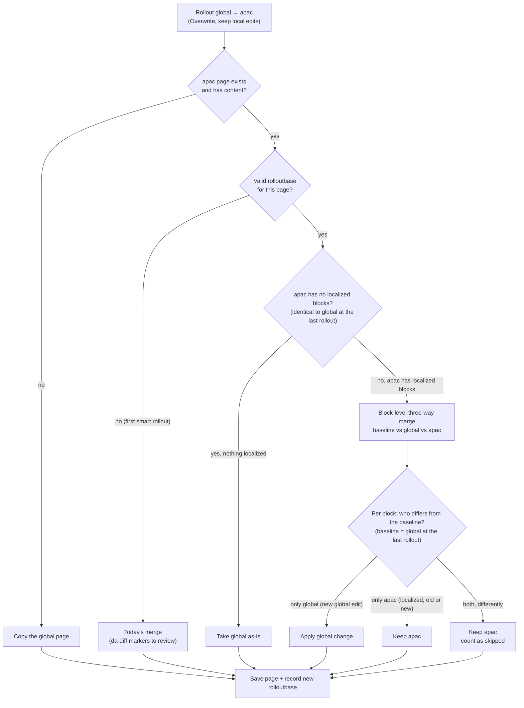

# Rollout: Overwrite (keep local edits)

`smart-overwrite` is an opt-in rollout behavior. It rolls out only the upstream (e.g. global) changes made since the
last rollout to each destination (e.g. apac) and keeps blocks the destination has localized.

Existing `overwrite` and `merge` behaviors are unchanged.

## Enabling

Add `smart-overwrite` to `rollout.conflict.behavior` in the site's `/.da/translate.json` config sheet, for example:

| key | value |
|---|---|
| `rollout.conflict.behavior` | `merge, overwrite, smart-overwrite` |

- **Loc app**: the value appears in the "On rollout" option (the first value stays the default).
- **Library rollout plugin**: "Overwrite (keep local edits)" appears in the Behavior select.

## How it works



Each smart rollout stores a baseline in the destination's `da-metadata`:

```
rolloutbase = <destination path>|<ordered upstream block hashes>
```

The next smart rollout does a block-level three-way merge (diff3, like `git merge`) of baseline (B), current
upstream (S) and destination (D). Logic lives in `nx/blocks/loc/regional-diff/smart-merge.js`.

1. Diff B→S and B→D into change hunks (ranges of baseline blocks replaced by new blocks). Equal-length replacements
   are treated as in-place edits of each block.
2. Hunks from the two sides that overlap form a cluster. Adjacent changes do not overlap, so an upstream edit or
   insert next to a localized block is still applied.
3. Each cluster is resolved:

| Upstream | Destination | Result |
|---|---|---|
| changed | unchanged | apply upstream change (edit, insert, delete) |
| unchanged | changed | keep destination |
| changed identically | changed identically | keep destination |
| inserted at a spot | inserted at the same spot | keep both (destination first, no duplicates) |
| changed | changed differently | keep destination, count as **skipped** |

4. Upstream reorders: if the destination has no localized blocks (it is still identical to upstream as of the last
   rollout), the result is exactly upstream (reorders included). Otherwise, like merge, upstream moves are not applied: moved blocks stay in the
   destination's order (not reported), so content is never duplicated, lost or resurrected.
5. Sections: new sections inserted by both sides at the same spot are compared whole, so boundaries and section
   metadata stay with their content. Section breaks that would leave an empty section after merging are dropped,
   unless the destination or upstream already has an empty section.

Guarantees (covered by seeded randomized tests in `test/loc/smart-merge.test.js`):
- Destination identical to the baseline (nothing localized) → result equals upstream.
- Upstream unchanged, or equal to the destination → result equals the destination.
- Every block the destination added or edited is kept.
- No block appears more often than in the destination plus the copies upstream newly added; locally deleted
  blocks never come back.
- A block present exactly once in the baseline, upstream and destination is always kept.
- The merge never creates an empty section.
- If nothing is reported as skipped, every new upstream block was applied.

Skipped counts are shown per locale (Loc app) and per destination (plugin) as "N skipped (localized)".

- No baseline yet (first smart rollout, or a baseline recorded for a different path): falls back to today's merge
  output (with `da-diff-*` markers) and records the baseline.
- Missing destination, or an empty one without a baseline: the upstream page is copied as-is and the baseline is
  recorded. An empty destination with a baseline was emptied on purpose and is merged like any other.
- Read or save failures and malformed documents are reported as errors; smart-overwrite never falls back to a
  plain overwrite.
- Only smart rollouts read or write `rolloutbase`; a later plain merge leaves a stale baseline, which is safe because
  identical changes are not treated as conflicts.
- Granularity is the block (paragraph, heading, block table, block group). Any edit inside a block counts as a
  change to that block, and blocks are matched by content: an upstream block that is both moved and edited is seen as
  a deletion plus a new block, so if the destination localized it both versions are kept for the author to tidy.
- A malformed `rolloutbase` is ignored, so the rollout falls back to the first-run merge.
