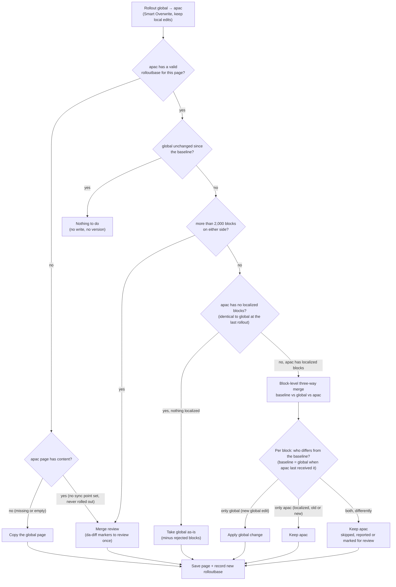

# Rollout: Smart Overwrite (keep local edits)

`smart-overwrite` is an opt-in rollout behavior. It rolls out only the upstream (e.g. global) changes made since the
last rollout to each destination (e.g. apac) and keeps blocks the destination has localized.

Existing `overwrite` and `merge` behaviors are unchanged.

## Enabling

Add `smart-overwrite` to `rollout.conflict.behavior` in the site's `/.da/translate.json` config sheet, for example:

| key | value |
|---|---|
| `rollout.conflict.behavior` | `merge, overwrite, smart-overwrite` |

- **Loc app**: the value appears in the "On rollout" option (the first value stays the default). Projects that use
  it also get a **Set sync point** action per language (see below).
- **Library rollout plugin**: "Smart Overwrite (keep local edits)" and "Set sync point (no content change)" appear in
  the Behavior select.

Everything on this page (baselines, sync points) only happens on sites that opt in. Other sites behave exactly as
before.

## How it works



Each page stores a baseline in its `da-metadata`: the upstream page as this page last received it.

```
rolloutbase = <destination path>|<ordered upstream block hashes>
```

On opted-in sites the baseline is recorded by:
- every smart rollout ("Smart Overwrite (keep local edits)");
- plain **merge** and **overwrite** rollouts from the Loc app (including the legacy project rollout view) or the
  Library plugin (overwrite: the page now equals upstream; merge: upstream at review time, so blocks the author keeps
  local stay local afterwards);
- **Set sync point** (below).

Pages are converted to the editor's form before they are compared (see "Editor form" below), so content outside
`main > div` sections is put into sections and a baseline can always be computed. An error while computing the
baseline fails the page before anything is saved. If the translation config can't be read, an overwrite proceeds as
on a site that hasn't opted in (the page gets no sync point, so its next smart rollout is a merge review). This is
only logged to the console, as the site may not have opted in.

Plain merge and overwrite rollouts on sites that haven't opted in, and every other caller (translations, sync,
snapshots, the public `mergeCopy` and `overwriteCopy`), remove the page's `rolloutbase` and `rolloutorder` rows: the
page no longer matches them. Snapshot copies are the exception (below).

Snapshots, translations and sync do not record baselines, and neither do rollouts or sync points into snapshot
paths (`/.snapshots/…`). A snapshot keeps the page's baseline: creating a snapshot copies the live page's
`rolloutbase` and `rolloutorder` rows into it, and overwriting or merging it back keeps them, so edits made in a
snapshot count as local edits. That baseline is keyed to the live page, so a smart rollout into a snapshot is a merge
review. The public `mergeCopy`
([loc-copy.md](loc-copy.md)) can't tell whether its source is the page's rollout parent, so it removes the baseline
and the next smart rollout to that page is a merge review. Translations and sync write the upstream (language)
pages, so they are upstream edits that roll out normally.

The next smart rollout does a block-level three-way merge (diff3, like `git merge`) of baseline (B), current
upstream (S) and destination (D). The merge logic lives in the `@adobe/da-merge` package
([da-tools](https://github.com/adobe/da-tools/tree/main/da-merge)), bundled in `nx/deps/da-merge`.
`nx/public/loc/copy.js` only reads the pages and config, calls da-merge's `applyCopy` or `markInSync`, saves the
result and saves a version.

1. Diff B→S and B→D into change hunks (ranges of baseline blocks replaced by new blocks). Equal-length replacements
   are treated as in-place edits of each block.
2. Hunks from the two sides that overlap form a cluster. Adjacent changes do not overlap, so an upstream edit or
   insert next to a localized block is still applied.
3. Each cluster is resolved:

| Upstream | Destination | Result |
|---|---|---|
| changed | unchanged | apply upstream change (edit, insert, delete) |
| unchanged | changed | keep destination |
| changed identically | changed identically | keep destination |
| inserted at a spot | inserted at the same spot | keep both (destination first, no duplicates) |
| changed | changed differently | keep destination: **skipped**, reported or **needs review** (below) |

When both sides changed the same region, the destination wins. What the report says depends on whether the result
may be wrong (notation: baseline → upstream / destination):

| # | Case (example) | Result | Report |
|---|---|---|---|
| 1 | Both edited the same block (`A B C` → `A G C` / `A L C`) | `A L C` | skipped |
| 2 | The page deleted a block upstream edited (`A B C` → `A B2 C` / `A C`) | `A C` | skipped |
| 3 | Upstream deleted a block the page edited (`A B C` → `A C` / `A L C`) | `A L C` | skipped, and the page is listed under "upstream removed an edited block" |
| 4 | Upstream moved and edited a block the page edited (`A X B C` → `A B C X2` / `A Xl B C`) | `A Xl B C X2`, `Xl` marked Local | needs review |
| 5 | Upstream removed one of two identical copies, the page edited one (`A B B C` → `A B C` / `A B Bl C`) | `A B Bl C`, `Bl` marked Local | needs review |
| 6 | Upstream's change also covers blocks the page didn't touch (`A B C` → `A2 Y B C` / `L B C`) | upstream's `A2 Y` (Upstream) before `L` (Local), then `B C` | needs review |
| 7 | Upstream added content to a section the page removed (or anything else of rows 4–6 that holds a section break) | the destination's version, no markers; an addition at the end of the removed section is applied to the section before it | skipped |
| 8 | Both inserted at the same spot, one of them with a section break | the destination's version, no markers | skipped |

- Rows 1–3 and 7–8 count as skipped. Rows 7–8 leave no markers, so the author compares the page with upstream by
  hand; marking them needs stored markup for section breaks, which is not built yet. Rows 4–6 mark the page, so it is
  listed under "needs review".
- Rows 3, 4 and 5 look the same inside the conflict (upstream deleted, the page changed). A deleted block that
  repeats in the baseline is row 5; otherwise, if upstream also added a new block anywhere on the page (a possible
  move), it is row 4; otherwise row 3. An unrelated upstream addition elsewhere therefore turns a row 3 case into
  row 4, so the author sees more, not less.
- Marked blocks use the `da-diff-*` markup, grouped per conflict: one `<da-diff-deleted data-mdast="ignore">` around
  consecutive Upstream blocks (merge writes the same attribute, which the editor also saves, so a preview of a page
  nobody has opened yet leaves the Upstream blocks out); for Local, exactly like merge, the `da-diff-added`
  attribute on each block (on the first div of a block group; on the `<li>` for a list item). Every marker of a
  conflict also has the same `data-diff-group` id (`g1`, `g2`, …), a `data-diff-side` (`source` or `local`) and a
  `data-diff-kind` (`changed` or `added`). The first Upstream marker has `data-diff-reason="both-changed"` (or a
  fallback reason: `no-baseline`, `page-too-large`). The format is defined by da-merge; editors must run a
  `@adobe/da-parser` that keeps these attributes. When both sides hold the same kinds of blocks, the pair renders as
  a tabbed choice (Keep Local / Keep Upstream / Keep Both) in the editor; otherwise each side shows its own
  keep/delete, as in a merge review.
  Rows 4–5 mark only the page's copy, so after keeping it the author may need to delete the other copy by hand.
  In row 6 the editor shows the Upstream group and the Local blocks as separate boxes, each with its own
  keep/delete, as extra blocks do in a merge review (no tabbed choice).
- Row 6 offers upstream's whole change, so it can include blocks the page deleted: `| H A B` → `| H A Y B` / `| H`
  gives `| H` followed by `A Y B` marked Upstream, and an emptied page gets the whole upstream page marked. The
  page's own content is unchanged; the author deletes the Upstream group to keep the page as it was.
- Row 7 also covers upstream deleting a section the page edited (`| A | B C` → `| A` / `| A | Bl C`): the page keeps
  its section, but nothing is marked and the page isn't listed under "needs review" or "upstream removed an edited
  block", but it counts as skipped. The content is correct; the author has to find the section on the page.
- Like skipped changes, marked changes are not offered again: the next baseline already contains
  them. Markers still open on the page stay as they are (see "Unresolved review").

Blocks rejected in a merge review (the page's `rejectedhashes`) are treated as if upstream never had them: before
the merge they are removed from the upstream page, together with any section that held only rejected blocks, and
the rest of upstream is merged by the rules above. So the rest of an upstream replacement that holds a rejected block
is applied, and a block upstream replaced with only rejected blocks is deleted like any upstream deletion.
- Only single blocks are matched, by the same hash merge uses. Like merge, a rejection never applies to a block group
  or to one item of a list (a whole list can be rejected).
- Copies the baseline already holds are not removed: the merge then sees the page's choice as a local change. For
  example, after a merge review where the author rejected an upstream edit and kept their own block, the page keeps
  its block. Extra copies beyond the baseline's are removed.
- Rejected blocks that were left out are not recorded in the next baseline, so they stay out on later rollouts and
  upstream edits around them still apply.
- An emptied page without a baseline leaves rejected blocks out of the copy and keeps its `acceptedhashes` /
  `rejectedhashes`.

4. Upstream reorders: if the destination has no localized blocks (it is still identical to upstream as of the last
   rollout), the result is exactly upstream (reorders included). Otherwise an upstream move is applied when the moved
   block appears once in the baseline and once in the destination, and the destination left it unchanged in place
   (same baseline order relative to every other block that appears once on both).
   The merge is then checked against putting every move back: if it would keep different blocks, resolve fewer
   changes, or put a moved block on the other side of content only the page has (a section break or block the page
   added; blocks the page edited one for one count as the blocks they replaced), all moves are put back instead.
   So `|x H A B` → `|x H B A` / `|x H A |y B` keeps `A` in its section instead of moving it into the section the
   page created, and lists the page under "upstream reordered blocks". Moves that aren't applied (the destination
   edited the moved block, it repeats, a whole section moved, or a move crosses content only the page has) keep the
   destination's order, so content is never duplicated, lost or
   resurrected. The recorded baseline keeps that (unapplied) order, so later upstream edits to moved blocks still
   apply. Reordered sections are put back as whole units, so edits inside a moved section (such as its section
   metadata) stay with that section.
   - When moves were put back and the page still has two blocks in the baseline order that upstream swapped, the
     page is listed under "upstream reordered blocks"; reorders only the page made don't count. To list it only
     once, the rollout records a fingerprint of every block upstream swapped (in upstream's order and in the
     baseline's, which together define the swapped pairs) in a `rolloutorder` metadata row
     (`<destination path>|<hash>`), next to `rolloutbase`. The fingerprint doesn't depend on the page's own order,
     so the page is listed again only when upstream's reorder changes: adding, removing or editing other blocks
     doesn't list it again, while removing a swapped block does. Blocks upstream only edited in place count as the
     blocks they replaced, so editing a swapped block doesn't list it again either. Repeated identical blocks are compared by occurrence, and section breaks only
     when they are unique on both sides (plain sections all look the same). `threeWayMerge` returns the
     fingerprint as `swaps` (named by upstream's hashes and ordered by the next baseline: the stored value) and
     `swapsAsBase` (named and ordered by the current baseline: the compared value). If upstream only
     reordered, the page is otherwise unchanged and only that row is written. The row is removed once upstream's
     order no longer conflicts with the page's, and whenever a merge, overwrite or **Set sync point** records a
     new baseline.
5. Sections: new sections inserted by both sides at the same spot are compared whole, so boundaries and section
   metadata stay with their content. Section breaks that would leave an empty section after merging are dropped,
   unless the destination or upstream already has an empty section.

Guarantees (covered by seeded randomized tests in da-merge's `test/smart-merge.test.js`):
- Destination identical to the baseline (nothing localized) → result equals upstream, minus rejected blocks.
- Upstream unchanged, or equal to the destination → result equals the destination.
- Every block the destination added or edited is kept.
- No block appears more often than in the destination plus the copies upstream newly added; locally deleted
  blocks never come back.
- A block present exactly once in the baseline, upstream and destination is always kept.
- The merge never creates an empty section, except one (the last) when every upstream block was rejected: a
  saved empty page still has one section.
- If nothing is reported as skipped or needing review, every new upstream block was applied, except blocks in the
  destination's `rejectedhashes`, which are never added (also on later rollouts).
- Applying moves (rule 4) changes only the order: the result holds the same blocks, markers and counts as putting
  every move back.

Skipped counts are shown per locale (Loc app) and per destination (plugin) as "N not applied (kept local)". A skipped
change is not offered again: the next baseline already contains it. Conflicts with markers still open on the
page also count as skipped (see "Unresolved review").

Known limitation: a section break dropped as empty (rule 5) stays in the baseline. Upstream content added to that
section later counts as skipped (row 7): added at the end of the section it is applied to the section
before it; added anywhere else in it, it is not applied. Leaving the break out of the baseline
instead would let it come back on later rollouts and move localized blocks into it (see the "keeps local content in
its section" test).

Known limitation: the "upstream reordered blocks" check matches a page's edited block to the block it replaced
only when it was replaced one for one. If the page replaced a moved block with a different number of blocks, the
move is still not applied (local wins) but the page is not listed. If upstream later replaces a swapped block with a
different number of blocks (e.g. edits it and adds one next to it), the page is listed again once, even though
upstream's order didn't change.

Known limitation: when upstream moves a block and adds one next to it in the same rollout (`| E I` → `| I N E` /
`| I E`), the new block is applied, but the page is listed under "upstream reordered blocks" only on the next
rollout. When the page itself moved a block so that upstream's move no longer changes it (`A B C` → `B A C` /
`A C B`), the page keeps its order and is not listed. The page's order is never changed by either.

Known limitation: upstream moving and editing a block the page edited, while also replacing another block at the
spot it moved to (`A X B C D` → `A B X2 D` / `A Xl B C D`), looks like an in-place edit (`C` → `X2`) plus a
deletion of `X`. It is treated as row 3: the result `A Xl B X2 D` has no markers, and the page is listed under
"upstream removed an edited block", so the author still opens it and finds both `Xl` and `X2`.

Known limitation: if the page deleted the same block upstream deleted and edited the block next to it
(`A B C D` → `A C D` / `A Cl D`), the merge can't tell this apart from editing the deleted block, so the page is
listed under "upstream removed an edited block" (or marked for review if upstream also added blocks). The content is
correct; the listing is a false positive.

Each smart rollout also reports, per page:
- **unchanged**: nothing new to apply since the sync point (upstream unchanged, or only rejected changes), so
  nothing was written except the `rolloutorder` row when upstream's reorder changed, and the page has no open
  markers. A write of only the `rolloutorder` row saves no version (Loc app: "N unchanged" per locale; plugin:
  "unchanged").
- **needs review**: after the rollout, the page has `da-diff-*` markers to accept or reject in the editor, also when
  nothing was written (e.g. a first rollout without a sync point, or an uncertain case: rows 4–6 above).
  The Loc app lists these pages under each locale, each linking to the page in the DA editor; in the plugin, "needs
  review" links to the page. The list is saved with the project and replaced by the next rollout.
- **upstream removed an edited block** (row 3): the page kept its edited block. The Loc app lists these pages under
  "Upstream removed a block these pages edited (local version kept):"; in the plugin, the label links to the page.
- **upstream reordered blocks** (rule 4): the page kept its order for at least one upstream move. The Loc app
  lists these pages under "Upstream reordered blocks on these pages (some moves not applied):"; in the plugin,
  the label links to the page.

Merge and overwrite rollouts, and the legacy project rollout view, report none of these.

- Unresolved review: while the destination still has `da-diff-*` markers (e.g. a first-run merge review that
  was not resolved yet):
  - With a baseline, adjacent open markers are kept as one fixed block. They are not diffed again, and the
    three-way merge runs on the rest of the page against the baseline, so new upstream changes are applied and new
    conflicts get new groups. An upstream change that touches an open group keeps the page as it is there and
    counts as skipped. Pending upstream changes keep showing until the author resolves them.
  - Without a baseline, the rollout is a merge review again, honoring earlier accept/reject decisions.
  - In a list with open markers, the items are merged one by one around them, so upstream changes to other items
    still apply.
  - An open group whose upstream side now matches the page's own side is cleared.
  - When upstream didn't change since the baseline, nothing is written, and the page is still listed under "needs
    review".
  - Markers include the `da-diff-added` attribute and the older `<da-diff-added>` element inside list items (the
    editor form turns it into the attribute on the `<li>`).

- No valid baseline yet (no sync point set and never rolled out on this site, or a baseline that is malformed or
  recorded for a different path):
  - Destination already identical to upstream: its content is kept and the baseline is recorded.
  - Otherwise a merge review (every difference marked with `da-diff-*` for the author to review once, with reason
    `no-baseline`, honoring earlier accept/reject decisions), and the baseline is recorded.
  - To skip that one-time review for content that already exists (e.g. after an import), use **Set sync point**.
- Nothing changed upstream since the baseline: nothing is written and no version is saved.
- Missing destination, or an empty one without a baseline: the upstream page is copied (an emptied page leaves
  out blocks it rejected and keeps its review decisions) and the baseline is recorded. An empty destination
  with a baseline was emptied on purpose and is merged like any other.
- Large pages: when upstream or the destination has more than 2,000 units (blocks and section breaks), the rollout
  is a merge review with reason `page-too-large`, and the baseline is recorded.
- Read or save failures, and a destination read that is empty but successful, are reported as errors and nothing is
  written; smart-overwrite never falls back to a plain overwrite. As in the other modes, a failed version save after
  a successful page save is reported as an error although the page was written.
- Granularity is the block (paragraph, heading, block table, block group). Any edit inside a block counts as a
  change to that block (whitespace is ignored except inside code blocks, `<pre>`), and blocks are matched by
  content: an upstream block that is both moved and edited is seen as a deletion plus a new block, so if the
  destination localized it both versions are kept, the localized one marked for review (row 4).

## Editor form

Every copy (smart-overwrite, merge and overwrite) first converts upstream and the
destination to the form the editor saves (`doc2aem(aem2doc(html))` from `@adobe/da-parser`), compares them in that
form and saves the result in it. So a page nobody edited never shows false local changes, and:
- Section wrapper attributes (e.g. `<div id="…">`), empty paragraphs, header and `<head>` content are dropped, as an
  editor save would drop them.
- Content outside `main > div` sections is put into sections, so it is merged and gets a baseline like any other.
- Metadata values are kept as written.
- Hashes stored before this change (`rolloutbase`, `acceptedhashes`, `rejectedhashes`) are matched to the editor
  form, so existing sync points and review decisions keep working.

If the conversion would lose content (it changes the visible text, a metadata value, or the number of images,
pictures, videos or links), the copy fails and nothing is written. Examples are a second `<main>`, or content an API wrote in a form the
editor can't hold. The error tells the author to open the source and the destination in the editor, save them, and
copy again. Saving in the editor converts the page, so the next copy works.

## Set sync point

For pages that already exist on both sides (e.g. imported content) and have no baseline yet. It records the
upstream page's **current** content as the baseline and changes nothing else, so later smart rollouts apply only
upstream edits made after that moment and keep every existing local difference.

- **Loc app (bulk)**: in a project whose rollout behavior is "smart-overwrite", each language has **Set sync point**
  (next to Rollout). It first checks every page × locale and shows counts (ready to set, already set, missing,
  unresolved review, sheets) and how many blocks exist only on the locale pages (kept as local), then
  **Confirm sync point** writes.
- **Library plugin (per page)**: choose "Set sync point (no content change)" and the regions, then **Set sync point**.
  Each region shows the result.
- Pages that already have a baseline, missing or empty pages, sheets and pages with an unresolved review are skipped.
  The page itself is saved as it is, with only the `rolloutbase` row added (upstream is converted to the editor
  form to compute it). Full HTML documents stay whole, `<head>` included.
  Each page that is set gets a version labelled "Sync point set". Placeholders are filled for each locale, as in a
  rollout.
- **Run it right after the import, before anyone edits the upstream pages.** Upstream edits made before setting it are
  treated as already handled and never roll out. For chains (global → region → locale), set the sync point on every
  level before editing any of them.
- Undo: delete the `rolloutbase` row; the next smart rollout is a merge review again. (The "Sync point set"
  version already contains the baseline, so restoring it does not undo it.)
